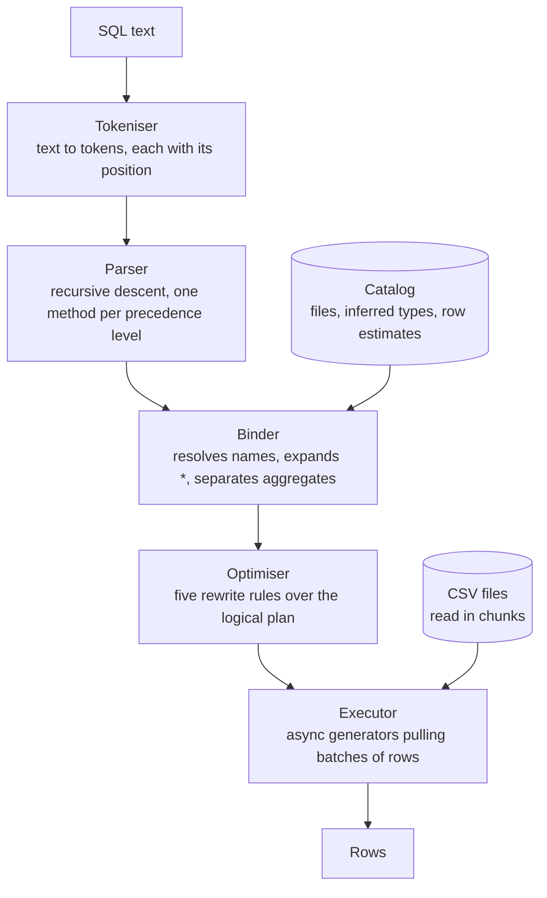

# csvql

A SQL query engine for CSV files, written from scratch in JavaScript. It has its
own tokeniser, parser, query planner, optimiser and streaming executor, and no
runtime dependencies.

[](https://github.com/anthonywalsh135/csvql/actions/workflows/ci.yml)


```bash
npm install
npm run demo
```

A query names CSV files as tables. Nothing is imported or indexed first.

```
$ csvql -d examples/data "SELECT c.country, COUNT(*) AS orders,
      ROUND(SUM(o.quantity * p.price), 2) AS revenue
    FROM orders o
    JOIN customers c ON o.customer_id = c.id
    JOIN products p ON o.product_id = p.id
    WHERE o.status = 'delivered'
    GROUP BY c.country ORDER BY revenue DESC LIMIT 5"

 country        | orders | revenue
----------------+--------+-----------
 United Kingdom |    285 | 114719.17
 Germany        |    244 |  107552.5
 Spain          |    198 |  84547.67
 Ireland        |    169 |  75288.89
 Italy          |    149 |  72192.46
(5 rows)
```

---

## Contents

- [What it does](#what-it-does)
- [Running it](#running-it)
- [How it works](#how-it-works)
- [Design decisions](#design-decisions)
- [Benchmarks](#benchmarks)
- [Testing](#testing)
- [Limits, and what I would build next](#limits-and-what-i-would-build-next)
- [Project layout](#project-layout)

---

## What it does

**Runs SQL on files as they are.** `FROM orders` reads `orders.csv` from the data
directory, and `FROM 'reports/2026.csv'` reads a path. The delimiter, the column
names and a type for each column are worked out from the first rows of the file.

**Covers the SQL that analysis is made of.** `SELECT` with expressions and
aliases, `WHERE`, inner, left and cross joins, `GROUP BY` and `HAVING` with
`COUNT`, `SUM`, `AVG`, `MIN` and `MAX` (and `DISTINCT` inside them),
`ORDER BY`, `LIMIT` and `OFFSET`, `DISTINCT`, `CASE`, `CAST`, `IN`, `BETWEEN`,
`LIKE`, `IS NULL` and 13 scalar functions. Logic is three-valued, so `NULL`
behaves the way it does in a real database.

**Plans before it runs.** An optimiser pushes filters down to the table they
read, turns joins on equality into hash joins, reads only the columns a query
uses, and replaces a sort followed by a limit with a bounded heap. `EXPLAIN`
shows the plan and `EXPLAIN ANALYZE` runs it and counts the rows through each
step.

**Streams.** Rows move through the plan in batches, and a file is read a chunk
at a time, so a scan with a filter holds one chunk of the file however large the
file is. A `LIMIT` stops the file being read: the first ten rows of a million
come back in 7 ms.

**Says what is wrong.** Errors point at the character that caused them, and a
misspelt name gets a suggestion:

```
$ csvql -d examples/data "SELECT name, contry FROM customers WHERE joined > '2025-01-01'"
error: unknown column "contry"; did you mean "country"?
  SELECT name, contry FROM customers WHERE joined > '2025-01-01'
               ^
```

**Checked against SQLite.** Every run of the test suite generates 600 random
queries, runs them here and in SQLite, and compares the rows. More on that under
[Testing](#testing).

---

## Running it

Node 22.13 or newer is needed. There is nothing to build.

```bash
npm install          # only the linter and the formatter; nothing is needed to run
npm run demo         # a few queries on the example data
npm start            # an interactive shell on the example data
```

### From the command line

```bash
node bin/csvql.js -d examples/data "SELECT * FROM products WHERE price < 20"
```

`npm link` makes that `csvql` everywhere. The options:

```
  -d, --dir <path>        where table names are looked up (default: .)
  -f, --file <path>       run the statements in a file
  -o, --format <format>   table, csv or json (default: table)
      --delimiter <char>  field delimiter of the files (default: detected)
      --no-optimize       run each query as written, with the optimiser off
```

A query can also be piped in, and `csv` and `json` output are written as the
rows are produced, so the result can be a file larger than memory:

```bash
csvql -d examples/data -o csv "SELECT category, COUNT(*) AS products, MAX(price) AS dearest
                               FROM products GROUP BY category ORDER BY 1"
```

```
category,products,dearest
Audio,6,315.5
Kitchen,7,328.99
Lighting,14,376.99
Office,9,383.5
Outdoor,4,294
```

### In the shell

Run with no query, `csvql` opens a prompt. Statements end with a semicolon and
can run over several lines.

```
csvql> .tables
customers  ~300 rows, 5 columns
orders     ~2,008 rows, 7 columns
products   ~40 rows, 4 columns
csvql> .schema orders
orders.csv, ~2,008 rows
  id           integer
  customer_id  integer
  product_id   integer
  quantity     integer
  status       text
  ordered_on   text
  shipped_on   text
```

The row counts are estimates, made from the size of the file and the length of
its first rows, which is why they are a little out.

### From code

```js
import { Database } from './src/index.js';

const db = new Database({ dir: 'examples/data' });

const { columns, rows } = await db.query('SELECT name, price FROM products LIMIT 3');

//rows arrive as they are produced; stopping early stops the file being read
const result = await db.stream('SELECT id FROM orders');
for await (const [id] of result.rows) {
  if (id > 100) break;
}
```

---

## How it works

A query goes through five stages. Each one is a separate module with its own
tests, and each hands the next a plain data structure.



1. **The tokeniser** turns text into tokens and records where each one starts,
   which is what lets every later stage report an error against the original
   text.
2. **The parser** is recursive descent, with one method per clause and one per
   level of operator precedence, so the code has the shape of the grammar.
3. **The binder** ties every name to one column of one table, expands `*`, and
   splits a grouped query into the aggregates and the expressions that read
   them. This is where `SELECT name, COUNT(*) FROM t` is refused.
4. **The optimiser** is a list of functions from a plan to an equivalent,
   cheaper plan.
5. **The executor** turns each node of the plan into an async generator that
   pulls batches of rows from the nodes beneath it. Expressions are compiled
   into closures once, so evaluating one for a row does not walk a tree.

The optimiser is easiest to understand by switching it off. This is a query the
way it is written, a cross product of two tables with a filter on top:

```
$ csvql -d examples/data --no-optimize "EXPLAIN SELECT c.country, COUNT(*) AS orders
    FROM orders o, customers c
    WHERE o.customer_id = c.id AND o.status = 'pending' AND c.newsletter
    GROUP BY c.country ORDER BY orders DESC LIMIT 3"

Limit 3
└─ Project c.country, COUNT(*) AS orders
   └─ Sort by COUNT(*) DESC
      └─ Aggregate by c.country: COUNT(*)
         └─ Filter o.customer_id = c.id AND o.status = 'pending' AND c.newsletter
            └─ Cross join
               ├─ Scan orders.csv as o (id, customer_id, product_id, quantity, status, ordered_on, shipped_on) ~2,008 rows
               └─ Scan customers.csv as c (id, name, country, joined, newsletter) ~300 rows
```

And this is what runs, here on the benchmark's million orders, with the rows
that actually passed through each step:

```
$ csvql -d bench/data/large "EXPLAIN ANALYZE SELECT ..."

Project c.country, COUNT(*) AS orders  [3 rows, 497.4 ms]
└─ Top 3 by COUNT(*) DESC  [3 rows, 497.3 ms]
   └─ Aggregate by c.country: COUNT(*)  [8 rows, 497.1 ms]
      └─ Hash join on o.customer_id = c.id (table from right)  [60,489 rows, 480.8 ms]
         ├─ Filter o.status = 'pending'  [99,828 rows, 364.7 ms]
         │  └─ Scan orders.csv as o (customer_id, status) ~1,059,053 rows  [1,000,000 rows, 345.7 ms]
         └─ Filter c.newsletter  [29,966 rows, 43.4 ms]
            └─ Scan customers.csv as c (id, country, newsletter) ~52,029 rows  [50,000 rows, 41.9 ms]

3 rows in 498.3 ms
```

Each rule has left its mark. The three parts of the `WHERE` clause went to three
different places. The equality became a hash join, built from the customers
because fewer of them survive their filter. The scans read two and three columns
instead of seven and five. The sort and the limit became a top-n that only ever
holds three rows. Times include the steps beneath.

---

## Design decisions

### Columns have ids, not positions

The binder gives every column a number, and expressions refer to columns by that
number for the whole of planning. A position in a row is only worked out when
the plan is turned into running code.

Had expressions used positions, every optimiser rule would have to renumber
every expression above the point it changed: push a filter below a join and its
column 7 is column 2. With ids, a rule moves an expression and nothing else
needs to know. Column pruning is the clearest case. It changes the layout of
every row in the query, and it is about 50 lines.

### Rows move in batches, pulled from the top

Each operator is an async generator, and the consumer at the top asks for rows.
That gives two things for free. A query reads its files only as fast as its
output is consumed, so piping a huge result to a slow reader does not fill
memory. And when a `LIMIT` has enough rows and returns, JavaScript closes the
generators beneath it in turn, which closes the file.

Reading is asynchronous, so a row at a time would mean an `await` per row per
operator. Operators exchange arrays of rows instead, usually a thousand or more
at a time, and the cost of the `await` is spread across them.

### Types are inferred, and a bad value does not stop the query

A CSV file has no types, so each column is given one from its first thousand
rows: integer, real, boolean or text. A later value that does not fit, such as
an `n/a` in a column of numbers, is left as text and the query carries on. This
is SQLite's model, and I chose it because real files are dirty. The cost is that
the mistake shows up later, as an error from `SUM` naming the value, and not
when the file is opened.

Two details came from thinking about what the data is likely to be. A whole
number with leading zeros, or with more than 15 digits, is kept as text: the
first is a postcode or a phone number, and the second cannot be held exactly in
a double and is nearly always an identifier. And an empty field is `NULL` while
`""` is an empty string, which is the only way a CSV file can tell them apart.

### One ordering for every value

Comparison operators, `ORDER BY`, `MIN` and `MAX` share a single ordering:
`NULL`, then booleans, then numbers, then text. Values of different types are
never converted to be compared, so `1 = '1'` is false and a sort of mixed values
cannot fail part way through.

### The optimiser's guesses are crude on purpose

The only choice that depends on row counts is which input of a hash join to
build the table from. A table's size is estimated from the file's size and the
length of its first rows, and a filter is assumed to keep a tenth of the rows
for an equality and a third for a range, the fixed fractions System R used.
These are often wrong, but the decision only needs them to be in the right
order, and being wrong costs memory and not correctness.

### A top-n that matches a stable sort exactly

`ORDER BY ... LIMIT 10` keeps a heap of the ten best rows seen so far in place
of sorting the input. A heap is not stable, so rows that tie on the sort key
could come out in a different order from the one a full sort gives. Each row
carries the order it arrived in as a last tie-break, which makes the two
identical. That matters for testing: the optimiser can be checked by asserting
that switching it off never changes a result.

### What differs from SQLite

`/` is always real division, as in MySQL and Oracle, so `7 / 2` is `3.5`.
`LIKE` ignores case, as SQLite's does. `ROUND` rounds halves away from zero and
works on the decimal form of the number, so `ROUND(1.005, 2)` is `1.01`. `SUM`
and `AVG` use compensated summation, so adding 0.1 a million times gives exactly 100000.

---

## Benchmarks

```bash
npm run bench
```

The first run generates a million orders (48 MB), 50,000 customers and 1,000
products into `bench/data`. Each query is run three times and the quickest is
reported. On a Ryzen 7 3700X with Node 24.19:

| Query                                         | Optimised | With one rule off | Rule               |
| --------------------------------------------- | --------: | ----------------: | ------------------ |
| `COUNT(*)` over 1,000,000 rows                |    309 ms |                   |                    |
| Group by status and sum                       |    418 ms |            568 ms | column pruning     |
| First 10 rows of the file                     |    7.0 ms |                   |                    |
| Latest 10 orders of 1,000,000                 |    435 ms |           1523 ms | top-n              |
| Join with a filter on each table              |    430 ms |           1101 ms | predicate pushdown |
| Three-table join and group, 1,000,000 orders  |   1269 ms |                   |                    |
| The same on 20,000 orders and 2,000 customers |   24.2 ms |           5657 ms | hash joins         |

A plain scan reads about 3.2 million rows, or 155 MB, a second. The hash join
is over 200 times quicker than nested loops even on the small data, and the gap
grows with the product of the table sizes, which is why the last row is not run
on the large data at all. The top-n is 3.5 times quicker than a full sort, and
pushing filters below a join 2.6 times quicker than filtering after it.

---

## Testing

```bash
npm test             # 250 tests
npm run coverage     # the same, with a coverage report and minimum thresholds
npm run lint
```

Coverage of `src/` is 99.4% of lines and 98.7% of branches. CI runs the suite on
Node 22, 24 and 26 on Linux, and on Windows.

**Against SQLite.** `test/differential.test.js` builds random tables, writes
them as CSV and loads the same rows into an in-memory SQLite database (the one
built into Node). It then generates random queries, with joins, grouping,
`HAVING`, `DISTINCT`, ordering and limits, runs each on both and compares the
rows. Every query is also run with the optimiser switched off, which has to
give the same answer a third time. The normal run is 600 queries;
`FUZZ_DATABASES=200 npm test` runs 10,000.

The generator keeps to the SQL where the two engines are meant to agree. It
never divides, because SQLite divides integers and csvql does not, and its real
numbers are multiples of a quarter, so that sums are exact whatever order they
are added in. To check that the comparison can fail, I broke the engine on
purpose in two places, pushing a filter through a left join and mishandling
`NULL` in `NOT IN`, and both were caught within a thousand queries.

**Cut at every offset.** The CSV parser takes its input in chunks and has to
give the same records wherever the chunks fall. One test feeds it the same
awkward document cut at every possible position, including the middle of a
`\r\n` and the middle of an escaped quote, and another writes random tables and
reads them back in random pieces.

**Plans as text.** The optimiser's tests compare `EXPLAIN` output with each rule
switched on by itself, so a test reads as a before and after.

---

## Limits, and what I would build next

- **No subqueries, `UNION`, window functions, or right and full joins.**
  Subqueries and right or full joins are refused by name, and the rest are
  syntax errors. Subqueries in `FROM` would come first, since the planner
  already treats every input as a tree.
- **Sorting, grouping and the built side of a hash join are held in memory.**
  Scans, filters and projections are not. An external merge sort that spills to
  disk is the obvious next step.
- **Joins run in the order they are written.** The optimiser picks the algorithm
  and the build side but does not reorder. With better row estimates, a dynamic
  programming search over join orders would be the largest single improvement.
- **There is no date type.** ISO dates compare correctly as text, but there is
  no date arithmetic.
- **Types come from the first 1,000 rows.** A file that changes character after
  that is handled row by row, as described above, and not by looking again.
- **Numbers are doubles.** Integers are exact up to 15 digits and longer ones
  are kept as text.
- **One thread.** A plain scan goes as fast as one thread can parse. Splitting a
  file between worker threads at record boundaries would be the way to scale it.

---

## Project layout

```
bin/csvql.js             the command
src/
  index.js               Database: the public interface
  catalog.js             table names to files, with cached schemas
  errors.js              error types, and showing one with a caret
  suggest.js             "did you mean", by edit distance
  sql/
    tokenizer.js         text to tokens
    parser.js            tokens to a syntax tree
    format.js            a tree back to text, for plans and for comparing
  csv/
    parser.js            incremental RFC 4180 parser
    reader.js            a file as batches of records
    schema.js            delimiter, column names, types and a row estimate
    types.js             type inference and conversion
    writer.js            csv output
  plan/
    binder.js            syntax tree to logical plan
    nodes.js             the plan nodes and how to walk them
    expressions.js       helpers over expression trees
    optimizer.js         the list of rules
    rules/               fold, pushdown, joins, topn, prune
    estimate.js          row estimates
    explain.js           a plan as text
  exec/
    executor.js          plan to running generators
    expression.js        expressions to closures
    operators.js         scan, filter, project, distinct, limit
    join.js              nested loop and hash joins
    group.js             hash aggregation
    sort.js, heap.js     full sort, and top-n with a bounded heap
    aggregates.js        COUNT, SUM, AVG, MIN, MAX
    functions.js         scalar functions
    values.js            ordering and hash keys
  cli/
    main.js              arguments, running a script, exit codes
    shell.js             the interactive prompt
    render.js            table, csv and json output
test/                    250 tests, including the check against SQLite
bench/run.js             the benchmark
scripts/generate-data.js the example and benchmark data
examples/                data, queries for the demo, and using it from code
```

---

## Licence

MIT. See [LICENSE](LICENSE).
